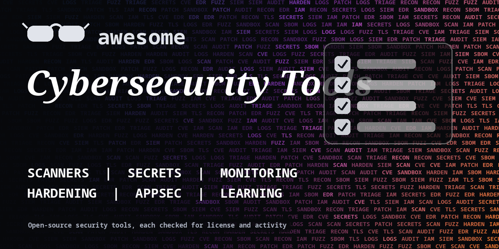

<h1 align="center">Awesome Cybersecurity Tools</h1>

> Open-source tools for scanning, monitoring, secrets, hardening and security learning. For defense and authorized testing. Every entry shows its license.

**Rules of this list:** every repo exists, is public, is not archived, states a license and has had a commit in the last year. One plain sentence each. Star counts and claims are the authors' own, we did not test every tool. Checked 2026-10-18. See [CONTRIBUTING.md](CONTRIBUTING.md).

## Contents

- [Vulnerability scanners](#vulnerability-scanners)
- [Application security and code scanning](#application-security-and-code-scanning)
- [Secrets and credentials](#secrets-and-credentials)
- [Monitoring, SIEM and detection](#monitoring-siem-and-detection)
- [Hardening and configuration](#hardening-and-configuration)
- [Network and web testing](#network-and-web-testing)
- [Cloud and infrastructure security](#cloud-and-infrastructure-security)
- [Privacy and identity](#privacy-and-identity)
- [Learning and practice](#learning-and-practice)
- [How to choose](#how-to-choose)
- [Contributing](#contributing)

## Vulnerability scanners

Find known issues in hosts, apps and containers.

- [anchore/grype](https://github.com/anchore/grype)  - Vulnerability scanner for container images and filesystems. _(Apache-2.0)_
- [aquasecurity/trivy](https://github.com/aquasecurity/trivy)  - Scanner for vulnerabilities, misconfigurations and secrets in containers and code. _(Apache-2.0)_
- [google/osv-scanner](https://github.com/google/osv-scanner)  - Vulnerability scanner using the OSV database. _(Apache-2.0)_
- [greenbone/openvas-scanner](https://github.com/greenbone/openvas-scanner)  - Open-source vulnerability scanner. _(GPL-2.0)_
- [OWASP/Nettacker](https://github.com/OWASP/Nettacker)  - Automated penetration testing and information gathering framework. _(Apache-2.0)_
- [projectdiscovery/nuclei](https://github.com/projectdiscovery/nuclei)  - Fast vulnerability scanner based on templates. _(MIT)_

## Application security and code scanning

SAST, dependency checks and fuzzing.

- [AFLplusplus/AFLplusplus](https://github.com/AFLplusplus/AFLplusplus)  - Fuzzing tool, the community-maintained AFL. _(AGPL-3.0)_
- [anchore/syft](https://github.com/anchore/syft)  - Generate a software bill of materials from images and filesystems. _(Apache-2.0)_
- [github/codeql](https://github.com/github/codeql)  - CodeQL queries and libraries for code analysis. _(MIT)_
- [google/oss-fuzz](https://github.com/google/oss-fuzz)  - Continuous fuzzing for open source software. _(Apache-2.0)_
- [PyCQA/bandit](https://github.com/PyCQA/bandit)  - Find common security issues in Python code. _(Apache-2.0)_
- [semgrep/semgrep](https://github.com/semgrep/semgrep)  - Lightweight static analysis for many languages. _(LGPL-2.1)_
- [SonarSource/sonarqube](https://github.com/SonarSource/sonarqube)  - Code quality and security analysis platform. _(LGPL-3.0)_

## Secrets and credentials

Find leaked keys and manage secrets.

- [bitnami/sealed-secrets](https://github.com/bitnami/sealed-secrets)  - Encrypt Kubernetes secrets so they are safe in git. _(Apache-2.0)_
- [getsops/sops](https://github.com/getsops/sops)  - Simple and flexible tool for managing secrets in files. _(MPL-2.0)_
- [gitleaks/gitleaks](https://github.com/gitleaks/gitleaks)  - Find secrets in git repos and files. _(MIT)_
- [hashicorp/vault](https://github.com/hashicorp/vault)  - Tool for managing secrets and protecting sensitive data. Source-available license. _(check repo)_
- [Infisical/infisical](https://github.com/Infisical/infisical)  - Open-source secrets management platform. _(check repo)_
- [trufflesecurity/trufflehog](https://github.com/trufflesecurity/trufflehog)  - Find, verify and analyze leaked credentials. _(AGPL-3.0)_
- [Yelp/detect-secrets](https://github.com/Yelp/detect-secrets)  - Enterprise-friendly way of detecting secrets in code. _(Apache-2.0)_

## Monitoring, SIEM and detection

Logs and alerts.

- [crowdsecurity/crowdsec](https://github.com/crowdsecurity/crowdsec)  - Collaborative, open-source security engine that blocks bad actors. _(MIT)_
- [fail2ban/fail2ban](https://github.com/fail2ban/fail2ban)  - Daemon that bans hosts causing repeated authentication failures. _(check repo)_
- [falcosecurity/falco](https://github.com/falcosecurity/falco)  - Cloud-native runtime security. _(Apache-2.0)_
- [OISF/suricata](https://github.com/OISF/suricata)  - Network intrusion detection and prevention engine. _(GPL-2.0)_
- [osquery/osquery](https://github.com/osquery/osquery)  - SQL-powered operating system instrumentation and monitoring. _(check repo)_
- [SigmaHQ/sigma](https://github.com/SigmaHQ/sigma)  - Generic signature format for SIEM systems. _(check repo)_
- [wazuh/wazuh](https://github.com/wazuh/wazuh)  - Open-source security platform for threat detection and monitoring. _(check repo)_
- [zeek/zeek](https://github.com/zeek/zeek)  - Powerful network analysis framework. _(check repo)_

## Hardening and configuration

Benchmarks and baselines.

- [aquasecurity/kube-bench](https://github.com/aquasecurity/kube-bench)  - Checks Kubernetes against the CIS benchmark. _(Apache-2.0)_
- [CISOfy/lynis](https://github.com/CISOfy/lynis)  - Security auditing tool for Unix-based systems. _(GPL-3.0)_
- [dev-sec/ansible-collection-hardening](https://github.com/dev-sec/ansible-collection-hardening)  - Ansible roles for hardening operating systems and services. _(Apache-2.0)_
- [inspec/inspec](https://github.com/inspec/inspec)  - Compliance and security testing framework. _(check repo)_
- [OpenSCAP/openscap](https://github.com/OpenSCAP/openscap)  - Standards-based compliance and vulnerability scanning. _(LGPL-2.1)_

## Network and web testing

For systems you are allowed to test.

- [nmap/nmap](https://github.com/nmap/nmap)  - The network mapper and security scanner. _(check repo)_
- [projectdiscovery/httpx](https://github.com/projectdiscovery/httpx)  - Fast HTTP toolkit for probing web servers. _(MIT)_
- [projectdiscovery/subfinder](https://github.com/projectdiscovery/subfinder)  - Passive subdomain discovery tool. _(MIT)_
- [rapid7/metasploit-framework](https://github.com/rapid7/metasploit-framework)  - Penetration testing framework. Use only with permission. _(check repo)_
- [sqlmapproject/sqlmap](https://github.com/sqlmapproject/sqlmap)  - Automatic SQL injection detection tool. Use only on systems you are allowed to test. _(check repo)_
- [wireshark/wireshark](https://github.com/wireshark/wireshark)  - Network protocol analyzer. _(GPL-2.0)_
- [zaproxy/zaproxy](https://github.com/zaproxy/zaproxy)  - The ZAP web app scanner, for systems you are allowed to test. _(Apache-2.0)_

## Cloud and infrastructure security

Check cloud and IaC configs.

- [aquasecurity/tfsec](https://github.com/aquasecurity/tfsec)  - Static analysis for Terraform. Now part of Trivy. _(MIT)_
- [bridgecrewio/checkov](https://github.com/bridgecrewio/checkov)  - Static code analysis for infrastructure as code. _(Apache-2.0)_
- [kubescape/kubescape](https://github.com/kubescape/kubescape)  - Kubernetes security platform with risk and compliance scanning. _(Apache-2.0)_
- [open-policy-agent/opa](https://github.com/open-policy-agent/opa)  - General-purpose policy engine. _(Apache-2.0)_
- [prowler-cloud/prowler](https://github.com/prowler-cloud/prowler)  - Cloud security assessment tool for AWS, Azure, GCP and Kubernetes. _(Apache-2.0)_

## Privacy and identity

Passwords, 2FA and privacy tools.

- [beemdevelopment/Aegis](https://github.com/beemdevelopment/Aegis)  - Free, secure and open-source 2FA app for Android. _(GPL-3.0)_
- [bitwarden/server](https://github.com/bitwarden/server)  - Server for the Bitwarden password manager. _(check repo)_
- [keepassxreboot/keepassxc](https://github.com/keepassxreboot/keepassxc)  - Cross-platform community fork of KeePass. _(check repo)_
- [WireGuard/wireguard-tools](https://github.com/WireGuard/wireguard-tools)  - Command-line tools for WireGuard VPN. _(GPL-2.0)_

## Learning and practice

Labs and training.

- [digininja/DVWA](https://github.com/digininja/DVWA)  - Damn Vulnerable Web Application for practice. _(GPL-3.0)_
- [juice-shop/juice-shop](https://github.com/juice-shop/juice-shop)  - Intentionally insecure web app for security training. _(MIT)_
- [OWASP/CheatSheetSeries](https://github.com/OWASP/CheatSheetSeries)  - Concise good practices for application security. _(CC-BY-SA-4.0)_
- [swisskyrepo/PayloadsAllTheThings](https://github.com/swisskyrepo/PayloadsAllTheThings)  - List of payloads and bypasses for web security testing. _(MIT)_
- [WebGoat/WebGoat](https://github.com/WebGoat/WebGoat)  - Deliberately insecure app for learning application security. _(check repo)_

## How to choose

- **Only test what you own or have written permission to test.**
- **Scanners give false positives.** Check findings by hand.
- **Keep tools updated.** Old signatures miss new threats.
- **Check the license.**

## Contributing

See [CONTRIBUTING.md](CONTRIBUTING.md). One entry per pull request, plain words, real sources only.

## About

Maintained by [@devanasolver](https://github.com/devanasolver). Listings follow the rules in CONTRIBUTING.

## Sponsor me

If this list is useful, [buy me a coffee](https://buymeacoffee.com/isaac49).
